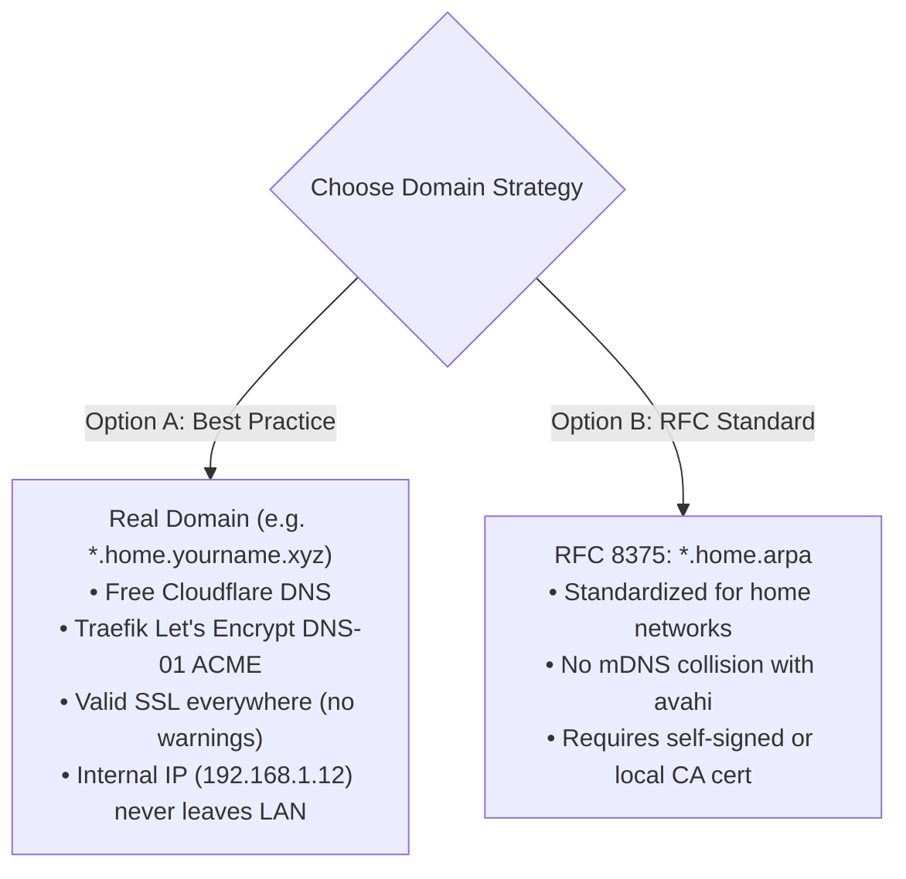
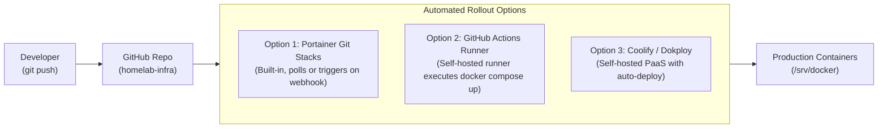

# Homelab Cleanup, Modernization & GitOps Migration Plan

This document outlines the findings from the system audit conducted on November 20, 2026, and provides a prioritized, actionable roadmap to resolve DNS conflicts, secure exposed ports, reclaim storage, eliminate configuration drift, and migrate the setup to an industry-standard GitOps workflow.

---

## Table of Contents
1. [Audit Findings Summary](#1-audit-findings-summary)
2. [Phase 0: Immediate Critical Fixes (Storage & Security)](#2-phase-0-immediate-critical-fixes-storage--security)
3. [Phase 1: DNS & Network Architecture Cleanup](#3-phase-1-dns--network-architecture-cleanup)
4. [Phase 2: Configuration & Service Harmonization](#4-phase-2-configuration--service-harmonization)
5. [Phase 3: GitOps Migration & Repository Structure](#5-phase-3-gitops-migration--repository-structure)
6. [Actionable Checklist](#6-actionable-checklist)

---

## 1. Audit Findings Summary

| Area | Current State | Issue / Risk | Target State |
| :--- | :--- | :--- | :--- |
| **Storage** | `/mnt/SandysHDD` at 96% (14GB free) | Database locks, qBittorrent write failures, Jellyfin transcode crashes. | Reclaim space, establish automated alerts & retention. |
| **Domain / TLD** | Using `*.nominomi.local` | Violates RFC 6762 (mDNS). Conflicts with host `avahi-daemon` and client OS mDNS responders. | Migrate to real domain (Cloudflare DNS-01) or RFC 8375 `.home.arpa`. |
| **DNS Server** | Technitium on host network (`:53`) | Heavy resource usage and host port contention solely to resolve one static wildcard. | Use lightweight AdGuard Home / Pi-hole or router DNS override. |
| **Port Security** | Containers expose `0.0.0.0:<PORT>` | Bypasses Traefik entirely. No auth, no HTTPS, no rate-limiting on LAN. | Isolated internal Docker bridge network (`traefik_proxy`); only Traefik exposes `80`/`443`. |
| **Traefik API** | `--api.insecure=true` on `:8080` | Unauthenticated dashboard and API visible to anyone on the network. | Secure with Traefik BasicAuth middleware or restrict to localhost. |
| **Docker Socket** | Mounted directly into Traefik & Portainer | Root-equivalent host access if a container is compromised. | Protect via Docker Socket Proxy (`tecnativa/docker-socket-proxy`). |
| **Configuration** | Split between CasaOS (`/data/compose`) and `/srv/docker` | Architectural drift; changes in one interface risk breaking the other. | Single unified Git repository managing all compose files. |
| **Git / Versioning**| No Git repository (`.git` missing) | Configuration changes are untracked; disaster recovery is manual. | Declarative GitHub repository with automated deployment. |

---

## 2. Phase 0: Immediate Critical Fixes (Storage & Security)

### 2.1 Reclaiming Disk Space on `/mnt/SandysHDD`
The drive `/mnt/SandysHDD` has only 14GB remaining. Running out of disk space will corrupt SQLite databases (Sonarr, Radarr, qBittorrent).

1. **Clean Incomplete & Orphaned Downloads:**
   * Inspect `/mnt/SandysHDD/Media/downloads` (or the torrent download directory).
   * Remove completed/unseeded torrents or incomplete files left over from failed downloads.
2. **Docker System Cleanup:**
   Prune dangling images, stopped build containers, and unused build caches:
   ```bash
   docker system prune -a --volumes=false
   ```
3. **Inspect Large File Consumers:**
   ```bash
   du -sh /mnt/SandysHDD/* 2>/dev/null | sort -h
   ```

### 2.2 Securing the Traefik Dashboard & API
Currently, Traefik exposes its dashboard and metrics on port `8080` without authentication.

* **Option A (Disable Insecure Mode - Recommended):**
  Edit `/srv/docker/traefik/compose.yml`:
  ```yaml
  # Replace:
  # - --api.insecure=true
  # With:
  - --api.dashboard=true
  ```
  Then route the dashboard securely through Traefik in `/srv/docker/traefik/routes.yml` protected by BasicAuth:
  ```yaml
  http:
    middlewares:
      admin-auth:
        basicAuth:
          users:
            - "admin:$$apr1$$xyz...hashed_password..."  # Generate with: htpasswd -nb admin password

    routers:
      traefik-dashboard:
        rule: "Host(`traefik.nominomi.local`)"
        entrypoints:
          - websecure
        service: api@internal
        middlewares:
          - admin-auth
        tls:
          domains:
            - main: "nominomi.local"
  ```
* **Option B (Localhost Only):**
  If only accessing via SSH tunnel, bind the port to `127.0.0.1`:
  ```yaml
  ports:
    - "127.0.0.1:8080:8080"
  ```

---

## 3. Phase 1: DNS & Network Architecture Cleanup

### 3.1 Resolving the `.local` / Technitium Conflict

#### Why `.local` Fails:
* **RFC 6762:** `.local` is reserved strictly for Multicast DNS (mDNS).
* **The Conflict:** Your server has `avahi-daemon` running (claiming `enma.local`). macOS (Bonjour), iOS, Windows, and Linux mDNS responders intercept any `.local` query and broadcast to multicast `224.0.0.251:5353`. They do **not** reliably query Technitium on port 53. This results in slow queries, timeouts, and intermittent failures.

#### Target Domain Strategy (Choose One):



1. **Option A (Industry Standard): Real Domain + Cloudflare DNS-01 Challenge**
   * Purchase a cheap domain (e.g., `.xyz`, `.net`, `.com` for $3–$10/year).
   * Manage DNS on Cloudflare (free).
   * Create an `A` record: `*.home.yourdomain.com -> 192.168.1.12` (DNS only / grey-clouded, not proxied).
   * Traefik automatically requests and renews Let's Encrypt wildcard certificates via DNS challenge. No router ports (80/443) need to be forwarded to the internet.
   * **Result:** Real SSL everywhere, no certificate warnings, zero DNS conflicts.

2. **Option B (Local-Only): Migrate to `.home.arpa`**
   * Replace `*.nominomi.local` with `*.nominomi.home.arpa`.
   * Unicast DNS resolvers respect `.home.arpa` without mDNS collision.

#### Resolving Technitium Overhead:
* If running Technitium only for a wildcard DNS rewrite, switch to **AdGuard Home** or **Pi-hole**:
  * Single lightweight binary.
  * Native ad-blocking and tracker blocking for all home devices.
  * One-click DNS rewrite: `*.home.arpa` -> `192.168.1.12`.
* Alternatively, if your router supports custom DNS records (e.g. pfSense, OPNsense, OpenWrt, UniFi), add the wildcard record directly on the router and remove the DNS container completely.

---

### 3.2 Network Isolation: Closing Host Ports

Currently, every container maps ports directly to the host (`0.0.0.0:8989`, `0.0.0.0:7878`, etc.).

#### The Isolated Proxy Architecture:
1. Create a dedicated external bridge network:
   ```bash
   docker network create traefik_proxy
   ```
2. Attach Traefik to `traefik_proxy`:
   ```yaml
   networks:
     - traefik_proxy
   ```
3. Remove published host `ports:` from individual service compose files (e.g., remove `8989:8989` from Sonarr).
4. Connect the service to `traefik_proxy`.
5. In Traefik (`routes.yml` or Docker labels), point the service directly to the container's internal name:
   ```yaml
   http:
     services:
       sonarr:
         loadBalancer:
           servers:
             - url: "http://sonarr:8989"   # Uses Docker internal DNS, not host IP!
   ```
* **Security Benefit:** Containers are shielded from the local network. Only Traefik has ports `80` and `443` open.

---

## 4. Phase 2: Configuration & Service Harmonization

### 4.1 Unifying CasaOS and `/srv/docker`
Currently, services are split between CasaOS (`/DATA/AppData`, `/data/compose`) and `/srv/docker/`.

* **Decision:** Choose a primary source of truth:
  * **Option 1 (Full GitOps - Recommended):** Decouple all services from CasaOS compose. Move service configurations to `/srv/docker/<app>/compose.yml`. Use CasaOS strictly as a dashboard/app viewer or decommission CasaOS compose management.
  * **Option 2 (Hybrid):** Leave storage paths on `/DATA/AppData` for persistent storage, but manage all compose files declaratively in `/srv/docker`.

### 4.2 Standardizing Directory Structure & Permissions
Standardize file ownership across all service directories:
```bash
# Set consistent ownership for user sandy (UID 1000) and docker group
sudo chown -R sandy:docker /srv/docker
sudo chmod -R 775 /srv/docker
```

---

## 5. Phase 3: GitOps Migration & Repository Structure

### 5.1 Repository Layout (`homelab-infra`)

Create a clean Git repository separating **declarative infrastructure code** from **runtime application state**:

```
homelab-infra/
├── .github/
│   └── workflows/
│       └── validate.yml         # Linting and YAML syntax verification
├── compose/
│   ├── core/
│   │   ├── traefik/
│   │   │   ├── compose.yml      # Traefik + Socket Proxy
│   │   │   └── config/
│   │   │       ├── traefik.yml  # Traefik static configuration
│   │   │       └── routes.yml   # Traefik dynamic file routes
│   │   └── dns/
│   │       └── compose.yml      # AdGuard Home / Technitium (if kept)
│   ├── media/
│   │   └── compose.yml          # Sonarr, Radarr, Prowlarr, qBittorrent, Bazarr
│   ├── streaming/
│   │   ├── jellyfin.yml
│   │   └── jellyseerr.yml
│   └── tools/
│       ├── glance.yml
│       ├── portainer.yml
│       └── sparkyfitness.yml
├── secrets/                     # SOPS-encrypted secrets
│   └── env.enc.yaml
├── scripts/
│   ├── deploy.sh                # Local pull-and-deploy script
│   └── backup.sh                # Backup trigger script
├── .gitignore
├── .env.example                 # Sanitized template
└── README.md
```

### 5.2 Strict `.gitignore` Policy
Ensure persistent state and secrets are never committed to GitHub:

```gitignore
# Runtime application data
**/data/
**/config/
**/assets/
**/media/
**/downloads/

# Secrets and keys
*.env
*.env.*
!*.env.example
*.key
*.crt
*.pem

# OS / Editor clutter
.DS_Store
Thumbs.db
*.log
```

### 5.3 Secrets Management: Mozilla SOPS + Age
Never commit plaintext credentials to Git. Use **Mozilla SOPS** with **age encryption**:

1. **Install `age` and `sops`:**
   ```bash
   sudo apt install age
   # Download SOPS binary from GitHub releases
   ```
2. **Generate Server Key:**
   ```bash
   mkdir -p ~/.config/sops/age
   age-keygen -o ~/.config/sops/age/keys.txt
   # Public key output: age1xyz...
   ```
3. **Configure `.sops.yaml` in repo root:**
   ```yaml
   creation_rules:
     - path_regex: secrets/.*\.ya?ml$
       key_groups:
         - age:
             - age1xyz...  # Server public key
   ```
4. **Encrypt / Decrypt Workflow:**
   ```bash
   # Encrypt file before commit:
   sops -e secrets/env.yaml > secrets/env.enc.yaml

   # Decrypt during deployment:
   sops -d secrets/env.enc.yaml > /srv/docker/.env
   ```

### 5.4 Automated Deployment (GitOps Engine)

Choose the deployment mechanism that best fits your workflow:



* **Option 1: Portainer Git Stacks (Recommended for lowest friction):**
  Since Portainer is already running on this machine:
  1. Open Portainer (`https://portainer.nominomi.local`).
  2. Navigate to **Stacks** -> **Add Stack** -> select **Repository**.
  3. Enter your Git repository URL, target branch (`main`), and path to the compose file.
  4. Enable **Automatic Updates** (via polling or GitHub webhook).
* **Option 2: GitHub Actions Self-Hosted Runner:**
  Install a GitHub runner on the server. On every push to `main`, GitHub Actions executes:
  ```bash
  git pull && docker compose pull && docker compose up -d --remove-orphans
  ```

---

## 6. Actionable Checklist

### Step 1: Storage & Security (Immediate)
- [x] Inspect and clear completed torrents/temp files on `/mnt/SandysHDD` (Usage reduced to 85% with 45GB free).
- [ ] Run `docker system prune -a` periodically or on demand.
- [x] Secure Traefik API (`:8080`) by removing `--api.insecure=true` and adding BasicAuth on `traefik.nominomi.lan` (see ADR-005).

### Step 2: Domain & DNS Migration
- [x] Choose target domain strategy: Migrated from RFC 6762 mDNS (`.local`) to private unicast domain `*.nominomi.lan` (see ADR-003).
- [x] Deprecate `*.nominomi.local` to remove mDNS collisions with `avahi-daemon`.
- [x] Configured Primary Zone and wildcard record (`*.nominomi.lan -> 192.168.1.12`) in Technitium DNS.
- [x] Updated Traefik routing configuration in `/srv/docker/traefik/routes.yml` and generated `nominomi.lan` wildcard certificate.
- [x] Deployed Cloudflare Tunnel for public domain `whatomate.nominomi.cloud` with verified Meta WhatsApp Cloud API webhooks.

### Step 3: Network Hardening
- [x] Create `traefik_proxy` Docker bridge network.
- [x] Connect Traefik and application containers to `traefik_proxy`.
- [x] Remove raw host `ports:` bindings from application compose files.
- [x] Deploy `tecnativa/docker-socket-proxy` to isolate `/var/run/docker.sock` with read-only permissions (see ADR-005).

### Step 4: GitOps Implementation
- [x] Initialize Git repository in `/srv/docker`.
- [x] Add comprehensive `.gitignore` to prevent committing persistent data, databases, and cleartext secrets.
- [ ] Connect remote GitHub repository and push initial commit.
- [ ] Set up Mozilla SOPS + age for encrypted environment variables.
- [ ] Connect Portainer Git Stacks or configure a CI/CD deployment webhook.
- [ ] Configure automated backups for persistent data volumes using Restic or Borg.

---
*Created as part of the server modernization plan. Last updated: November 2026.*
