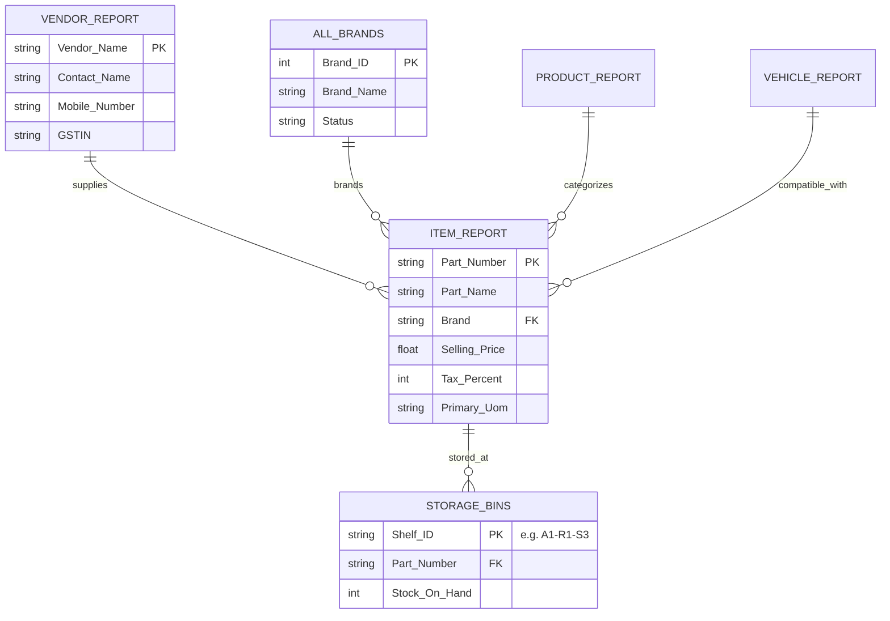

# AutoRox × Whatomate: Pillar 2 (Spare Parts & Inventory)

> **Implementation Guide & Operational Blueprint**  
> **Role Focus:** Storekeeper, Parts Manager, and Procurement Lead  
> **Platform Stack:** AutoRox Garage ERP + [Whatomate](https://github.com/shridarpatil/whatomate) (WhatsApp Business Gateway) + Python Inventory Microservice

---

## 1. Executive Summary & Objective

In a high-volume automotive garage, the spare parts counter is often the primary bottleneck:
1. **Manual Bill Inwarding Lag:** Invoices from distributors (*Vikas Trade Links*, *Autoverse*, *Bosch*) sit on desks for days before being entered into AutoRox, causing inventory mismatches.
2. **Floor Walkway Waste:** Mechanics and Service Advisors walk back and forth to the parts counter just to ask *"Do we have Creta brake pads?"* or *"Where is shelf A1?"*
3. **Emergency Stock-outs:** Fast-moving filters and lubricants run out unexpectedly because reorder levels aren't checked daily.

**Pillar 2** transforms WhatsApp into an **autonomous workshop inventory operating layer**:
- 📸 **Photo to Inward:** Snap a photo of a vendor invoice $\rightarrow$ AutoRox CSV generated and sent back on WhatsApp in 10 seconds.
- 💬 **WhatsApp Stock Lookup:** Technicians text `stock Creta oil filter` or `part 01245255084AV` $\rightarrow$ Bot replies with live stock, exact shelf location (`A1-R1-S3`), MRP, and base price.
- 🚨 **Automated 9:00 AM Low-Stock Digest:** Morning alert to storekeeper with 1-tap WhatsApp purchase orders directly to vendor sales reps.
- 📋 **Digital Job Card Pick Lists (MRN):** When parts are added to a Job Card, storekeeper receives an instant WhatsApp pick list with shelf coordinates.

---

## 2. Master Data Architecture (Directory Files)

This folder contains the master datasets exported from AutoRox:

```
autorox-whatsapp-spare-parts-and-inventory/
├── engine/                          # High-Performance Go Engine for Whatomate Webhooks
│   ├── main.go                      # Go webhook receiver & sub-millisecond stock search
│   ├── main_test.go                 # Benchmark & test suite (< 1ms query verification)
│   └── autorox-engine               # Compiled static binary for deployment
├── ocr_service.py                   # GPU-Accelerated OCR Microservice (PP-OCRv6 + CUDA)
├── Dockerfile.ocr                   # CUDA 12.1 runtime image for GTX 1050 Mobile
├── Dockerfile.engine                # Multi-stage Go engine container
├── Dockerfile.worker                # Python AutoRox sync worker container
├── docker-compose.yml               # Multi-container orchestration (Engine + GPU OCR + Sync)
├── data/                            # Workshop & Master Datasets
│   ├── master/                      # 1,938 SKUs, 31 Vendors, 3,151 Brands, Categories, Vehicles
│   └── live/                        # AutoRox_Live_Inventory.csv & inventory.db (SQLite WAL)
├── docs/
│   ├── adr/                         # Architecture Decision Records (ADRs 0001 - 0008)
│   ├── research/                    # Market Viability & ERP-Agnostic Scaling Reports
│   └── agents/                      # Domain & Issue Tracking Guidelines
├── .agents/skills/                  # Matt Pocock Engineering Skills (35 modular skills)
├── pillar2_inventory_service.py     # Python reference microservice & SQLite builder
├── sync_inventory.py                # AutoRox live inventory sync & proactive session cache
├── test_queries.py                  # Master data & query verification test suite
├── AGENTS.md                        # Agent operating manual & repository guidelines
├── GLOSSARY.md                      # Canonical automotive & ERP domain dictionary
└── README.md                        # This implementation blueprint
```

### Master Data Join Matrix


---

## 3. Workflow Specifications

### Workflow 2.1: WhatsApp Vendor Bill Inwarding (OCR $\rightarrow$ CSV)
* **Trigger:** Storekeeper sends an invoice photo or PDF to the workshop WhatsApp number.
* **Processing:**
  1. **Vendor Detection:** Matches header text against the 31 entries in `Vendor Report` (e.g. *VIKAS TRADE LINKS*, *AUTOVERSE*). Retrieves vendor GSTIN and payment terms.
  2. **Line Item Extraction:** Extracts Part Number, Description, Brand, Qty, MRP, Discount %, and Tax Rate (18% / 28%).
  3. **Brand Validation:** Cross-references extracted brands against `AutoRox_All_3151_Brands.csv`.
  4. **SKU Matching:** Checks `Item Report`:
     - **Existing SKU:** Maps directly to AutoRox `Part Number`.
     - **New SKU:** Prepares Step 1 Item Master import template and assigns standard category from `Product Report`.
  5. **Tax & Base Price Calculation:**
     $$\text{Tax Exclusive Base Price} = \frac{\text{Net Purchase Rate}}{1 + \frac{\text{GST \%}}{100}}$$
  6. **Shelf Assignment:** Suggests storage shelf based on category (e.g., Cabin Filters $\rightarrow$ `A1-R1-S1`, Oil Filters $\rightarrow$ `A1-R1-S3`).
* **WhatsApp Response:** Whatomate replies with an interactive summary and attaches the ready-to-upload `AutoRox_Direct_Inward.csv`.

---

### Workflow 2.2: Shop Floor Parts & Shelf Stock Lookup Bot
* **User Trigger:** Mechanics or Service Advisors send a text to the WhatsApp bot.
* **Commands Supported:**
  * `stock <car model> <part>`: (e.g. `stock Creta oil filter`, `stock Swift brake pads`)
  * `part <part number>`: (e.g. `part 01245255084AV`, `part F002H24945EHG`)
  * `vendor <name>`: (e.g. `vendor vikas`, `vendor autoverse`)
  * `shelf <shelf id>`: (e.g. `shelf A1-R1-S1`)
* **Bot Reply Card Example:**
  ```text
  🔍 *STOCK LOOKUP: Hyundai Creta Oil Filter*
  ─────────────────────────────
  • *Part:* FILTER, OIL (BOSCH)
  • *Part Number:* F002H235238F8
  • *Stock on Hand:* 4 units
  • *Physical Location:* 📍 *Rack A1 - Row 1 - Shelf S3*
  • *Pricing:* MRP ₹170.00 | Base Selling Price: ₹144.07
  • *UoM:* NO (Pieces)
  • *GST:* 18%
  ```

---

### Workflow 2.3: Automated Low-Stock Reorder Triggers (9:00 AM Cron)
* **Schedule:** Daily at 09:00 AM IST.
* **Logic:** Scans items where $\text{Current Stock} \le \text{Minimum Safety Threshold}$.
* **Vendor Association:** Retrieves primary vendor contact details from `Vendor Report`.
* **WhatsApp Alert Format:**
  ```text
  🚨 *DAILY LOW-STOCK REORDER ALERT (20-Nov-2026)*
  ─────────────────────────────────────────────
  The following fast-moving items are below safety stock:

  1. *BOSCH 5W-30 Engine Oil* (`F002H23760079`)
     - Current Stock: 8 Litres (Min: 50 Litres)
     - Preferred Vendor: *VIKAS TRADE LINKS* (Ranjith: +91 98860 XXXXX)
     - Suggested Reorder: 1x 50L Drum

  2. *Hyundai Creta Oil Filter* (`F002H235238F8`)
     - Current Stock: 1 unit (Min: 5 units) | Location: *A1-R1-S3*
     - Preferred Vendor: *AUTOVERSE* (Rajesh: +91 97410 XXXXX)
     - Suggested Reorder: 10 units

  ─────────────────────────────────────────────
  Reply *PO 1* to generate PO for Vikas Trade Links.
  Reply *PO ALL* to auto-dispatch POs to respective vendors via WhatsApp.
  ```

---

### Workflow 2.4: Floor Requisition & Material Pick List (MRN)
* **Trigger:** AutoRox Job Card adds spare parts for a vehicle currently in bay.
* **Notification to Storekeeper:**
  ```text
  📦 *NEW MATERIAL REQUISITION #MRN-1048*
  ─────────────────────────────────────────────
  • *Vehicle:* Hyundai Creta (KA03MG8812) | *Bay 2*
  • *Mechanic:* Suresh Kumar

  📋 *Parts Pick List:*
    [ ] 1x Oil Filter (`F002H235238F8`) ➔ 📍 *Shelf A1-R1-S3*
    [ ] 1x Cabin Filter (`F002H24945EHG`) ➔ 📍 *Shelf A1-R1-S1*
    [ ] 4x Litres 5W-30 Oil (`F002H23760079`) ➔ 📍 *Oil Dispenser Drum 1*

  ─────────────────────────────────────────────
  Tap [✅ All Parts Issued] once handed over.
  ```

---

## 4. Physical Warehouse Shelf Matrix

The warehouse uses a 3-tier coordinate system: `[Rack]-[Row]-[Shelf]`

| Rack Coordinate | Category | Typical Fast-Moving Contents |
| :---: | :--- | :--- |
| **`A1-R1-S1`** | Cabin / AC Filters | Creta, i20, Swift, Innova, Verna Cabin Filters |
| **`A1-R1-S2`** | Spark Plugs | Bosch 2-Wheeler / 4-Wheeler Suppressed Spark Plugs |
| **`A1-R1-S3`** | Oil Filters | Spin-on & Cartridge Oil Filters |
| **`A1-R1-S4`** | Air Filters | Paper & Polyurethane Engine Air Filters |
| **`A1-R2-S1`** | Wiper Blades | 14" to 26" Frame & Frameless Wiper Blades |
| **`A1-R2-S2`** | Brake Pads (Front) | TVS, Minda, Bosch Disc Brake Pads |
| **`A1-R3-S1`** | Engine Oils (Cans) | 5W-30, 0W-20, 15W-40 Synthetic & Mineral (1L/3.5L/4L) |
| **`A1-R3-S2`** | Brake Fluid & Coolant | DOT 4 Brake Fluid, Ready-to-use Coolants (1L) |
| **`A1-R3-S3`** | Bulk Fluids | 50L / 210L Oil Barrels |

---

## 5. How to Run the Service

### Prerequisites
```bash
pip install pandas openpyxl xlrd requests
```

### Test Master Data Searches (CLI Mode)
```bash
python3 test_queries.py
```

### Sync Live Inventory from AutoRox
```bash
# Syncs live workshop stock to AutoRox_Live_Inventory.csv / json & updates local DB
# Caches session token in .autorox_session.json (only refreshes when <20m remains)
python3 sync_inventory.py -u "whatomate" --update-db
```

### Run the High-Performance Go Engine (Recommended for Production)
```bash
# Starts the Go engine on :8000 (Sub-millisecond query latency, 15MB RAM footprint)
cd engine
./autorox-engine --port 8000 --db ../data/live/inventory.db --whatomate-url http://localhost:8090
```

### Alternatively, Run the Python Reference Microservice
```bash
python3 pillar2_inventory_service.py --port 8000
```

### Configure Whatomate Webhook
In Whatomate Settings $\rightarrow$ Webhooks:
- **Webhook URL:** `http://<your-server-ip>:8000/webhook/whatomate`
- **Events:** `message.create`

---

## 6. Architecture Decision Records (ADRs)

Key architectural, security, and operational decisions are documented under [`docs/adr/`](docs/adr/README.md):

| ADR | Title | Scope |
| :---: | :--- | :--- |
| [**0001**](docs/adr/0001-pillar2-architecture-and-infrastructure-topology.md) | Pillar 2 Microservice Architecture & Infrastructure Topology | System Topology & Hosting |
| [**0002**](docs/adr/0002-master-data-hybrid-storage-and-in-memory-sqlite.md) | Hybrid Master Data Engine & In-Memory SQLite Store | Data Model & Hybrid Engine |
| [**0003**](docs/adr/0003-role-scoping-and-storekeeper-least-privilege.md) | Role Scoping & Storekeeper Least Privilege Enforcement | Security & Principle of Least Privilege |
| [**0004**](docs/adr/0004-core-portal-controller-integration-over-rest-gateway.md) | Direct Operational Controller Integration over Public REST Gateway | AutoRox API Architecture |
| [**0005**](docs/adr/0005-proactive-session-caching-with-20-minute-refresh-window.md) | Proactive Session & Token Caching with 20-Minute Refresh Window | Performance & Auth Lifecycle |
| [**0006**](docs/adr/0006-accounting-compliant-stock-inwarding-workflow.md) | Accounting-Compliant Stock Inwarding via Direct Inward Engine | Financial & GST Ledger Integrity |
| [**0007**](docs/adr/0007-query-pagination-and-server-load-throttling.md) | Safe Query Pagination & Server Load Throttling | API Resilience & Stability |
| [**0008**](docs/adr/0008-hybrid-go-engine-and-python-domain-architecture.md) | Hybrid Go Core Engine & Python Domain Worker Architecture | Architecture & Performance |
| [**0009**](docs/adr/0009-gpu-accelerated-edge-ocr-pipeline.md) | GPU-Accelerated Edge OCR Pipeline for Vendor Invoices | Edge AI & Hardware Acceleration |
