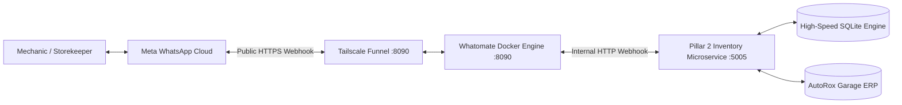

# ADR-0001: Pillar 2 Microservice Architecture & Infrastructure Topology

## Status
**Accepted**

## Context
Upshift Automotives requires automated workshop operations bridging **AutoRox Garage ERP** with **WhatsApp Business Platform** to empower floor mechanics, storekeepers, and procurement staff. The mechanics require immediate real-time answers for parts availability, physical shelf locations (e.g. `Rack A1 - Row 1 - Shelf S3`), current selling prices, and vendor contact lookups.

Existing constraints:
1. **Infrastructure**: Self-hosted home server (`sandy@enma` - Ubuntu 24.04 LTS, Intel i5/i7, NVIDIA GeForce GTX 1050 Mobile 4GB VRAM).
2. **Network**: Home server sits behind NAT with dynamic IP; must safely expose an HTTPS webhook endpoint to Meta WhatsApp Cloud API.
3. **Platform Choice**: The user deployed **Whatomate** (self-hosted WhatsApp Business multi-tenant orchestration platform) via Docker on port 8090.
4. **Latency Requirements**: Mechanics asking stock questions on WhatsApp must receive replies within < 2 seconds.

## Decision
We decided to adopt a **decoupled microservice architecture**:
1. **Whatomate Gateway Layer**: Whatomate runs inside Docker on `enma:8090` to handle Meta WhatsApp Embedded Signup, official WhatsApp Cloud API webhooks, media attachments, and message transport.
2. **Tailscale Funnel**: Secure public HTTPS ingress is established using Tailscale Funnel (`tailscale funnel --bg 8090`), providing a permanent public endpoint (`https://enma.<tailscale-domain>/webhooks/whatsapp`) with automatic TLS termination and zero port-forwarding on residential routers.
3. **Pillar 2 Core Microservice (`pillar2_inventory_service.py`)**: A lightweight, standalone Python service operating directly on `enma` (or in a sidecar container). It exposes an internal REST/HTTP interface (`localhost:5005`), consuming webhooks from Whatomate, running fast local search logic, and delivering replies back through Whatomate's outbound API.
4. **Local Hardware Acceleration**: Offline GPU OCR tasks (processing vendor invoice images) utilize the GTX 1050 Mobile (CUDA/TensorRT) directly on `enma`, avoiding third-party OCR API subscription costs.

## Consequences

### Positive
* **Zero Cloud Hosting Costs**: Leverages existing home server hardware (`enma`).
* **High Availability**: Tailscale Funnel provides zero-maintenance DDNS and TLS certificates.
* **Low Latency**: Parts queries execute against local in-memory SQLite tables in < 15ms.
* **Privacy & Isolation**: Master catalog and customer data remain on premises.

### Negative / Trade-offs
* Depends on residential internet stability and home server uptime.
* Requires automated restart policies (systemd services and Docker `restart: unless-stopped`).
