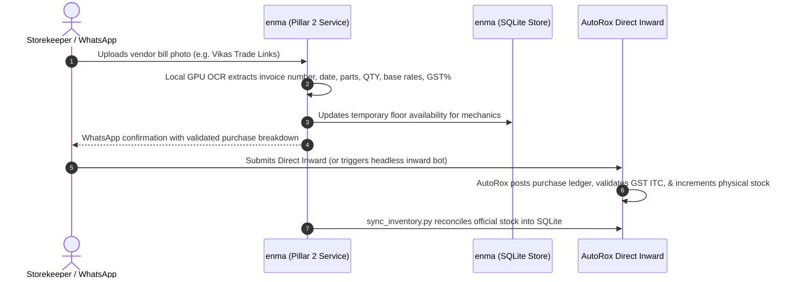

# ADR-0006: Accounting-Compliant Stock Inwarding via Direct Inward Engine

## Status
**Accepted**

## Context
A key requirement for Pillar 2 is keeping stock counts synchronized when new shipments of spare parts arrive at the workshop.

A naive integration approach would be to issue a direct write/increment command to update the stock table:
```sql
UPDATE inventory SET stock = stock + X WHERE part_number = '...';
```

However, AutoRox is an automotive enterprise resource planning (ERP) system enforcing statutory Indian GST compliance and double-entry purchase accounting. In AutoRox, stock cannot be created or incremented in isolation without backing legal purchase records. Incrementing raw stock without an invoice breaks:
1. **Purchase Journal Ledgers**: Unbalanced credits against vendor accounts.
2. **Input Tax Credit (ITC) Claims**: Missing tax invoices and HSN breakdown for GSTR-2B reconciliation.
3. **Average Weighted Purchase Costing**: Skewing profitability and gross margin calculations.
4. **Physical Shelf Tracking**: Stock not assigned to physical warehouse racks (`A1-R1-S1`).

## Decision
We decided to strictly route all stock inwarding through AutoRox's official **Direct Inward Engine** at:
`https://bcsin.autorox.co/inventoryPage/directInward`

The automated operational workflow is structured as follows:



1. **Mandatory Inward Metadata**:
   Every inward must contain:
   * **Vendor**: Matched against the 31 indexed vendors (e.g., `VIKAS TRADE LINKS`).
   * **Bill Type & Number**: e.g., `Delivery Receipt` / `Tax Invoice` with unique Bill No.
   * **Tax-Exclusive Unit Price**: Calculated as `Total / (1 + Tax% / 100)`.
   * **Physical Rack / Shelf Tag**: Tagged directly to workshop racks (e.g., `A1-R3-S2`).
2. **Dual-Stage Availability**:
   * **Stage 1 (Immediate Floor Availability)**: Mechanics asking WhatsApp for stock see incoming parts immediately upon bill photo receipt.
   * **Stage 2 (Official Financial Posting)**: Official ERP ledger reconciliation completes via Direct Inward, ensuring 100% tax and accounting integrity.

## Consequences

### Positive
* **100% GST & Statutory Compliance**: Guarantees accurate GSTR-2B Input Tax Credit matching.
* **Balanced Accounting Books**: Keeps vendor payment ledgers, purchase accounts, and workshop margins exact.
* **Physical Shelf Traceability**: Spares are physically tagged to identifiable racks and shelves.
* **Zero ERP Data Corruption**: Avoids orphan stock records or database lockups.

### Negative / Trade-offs
* Requires invoice photos to have readable vendor names, bill numbers, and line items.
* Involves a multi-step inwarding transaction rather than an instant single-cell database increment.
